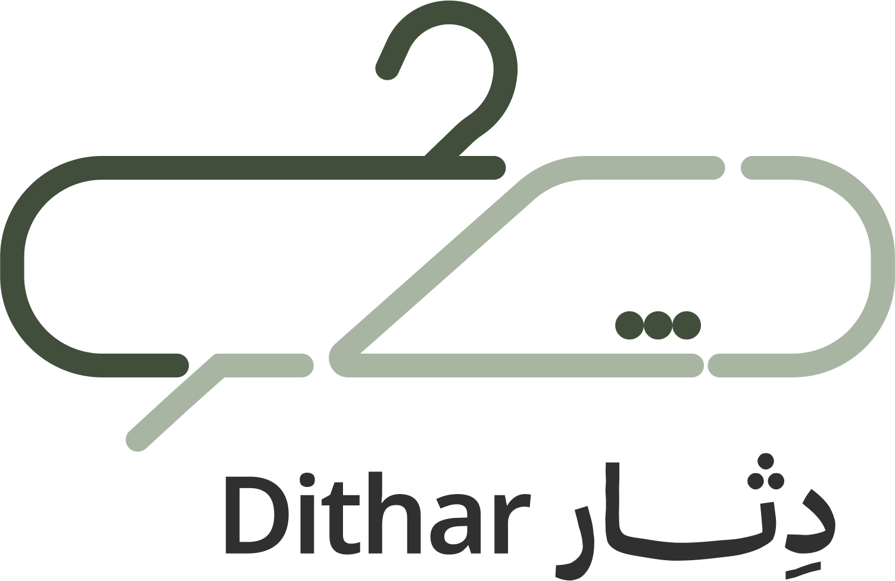
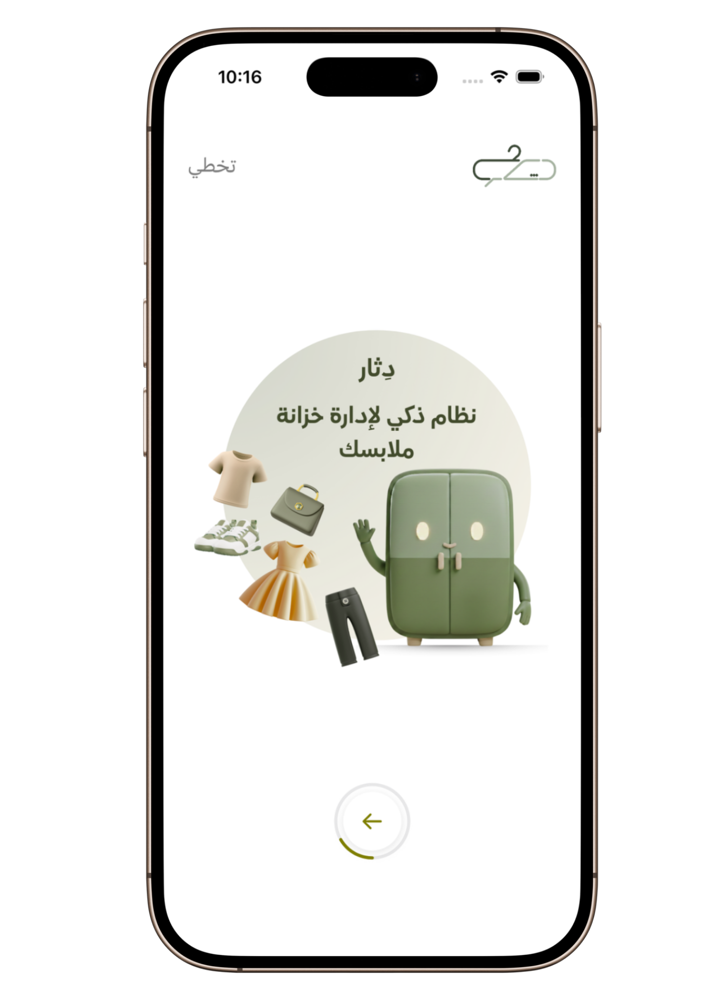
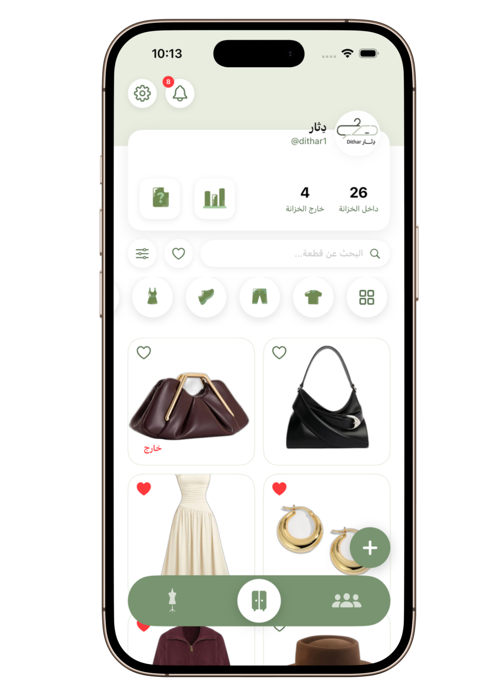
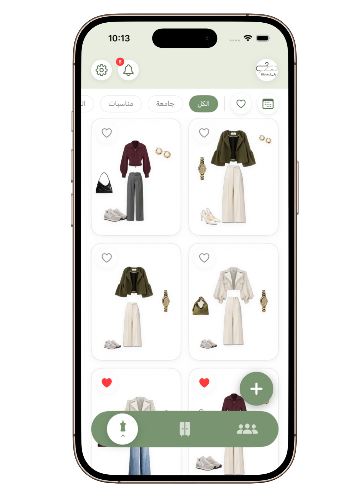
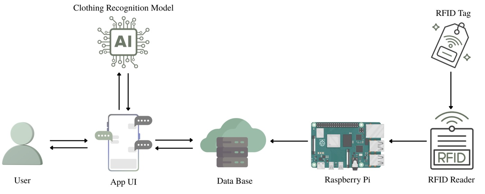
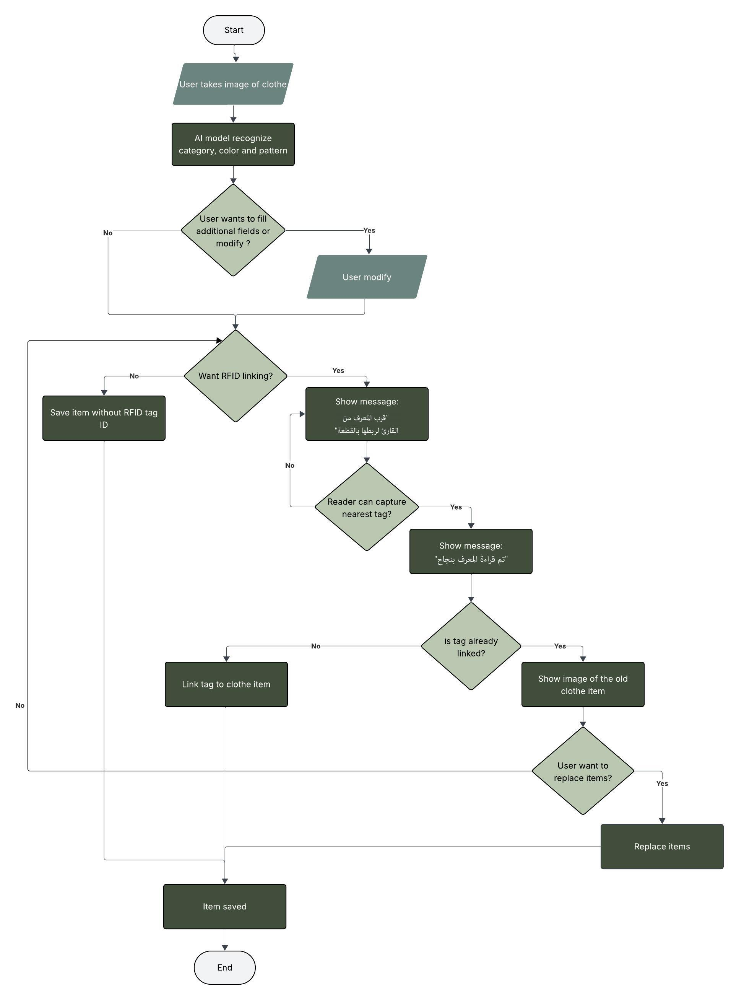
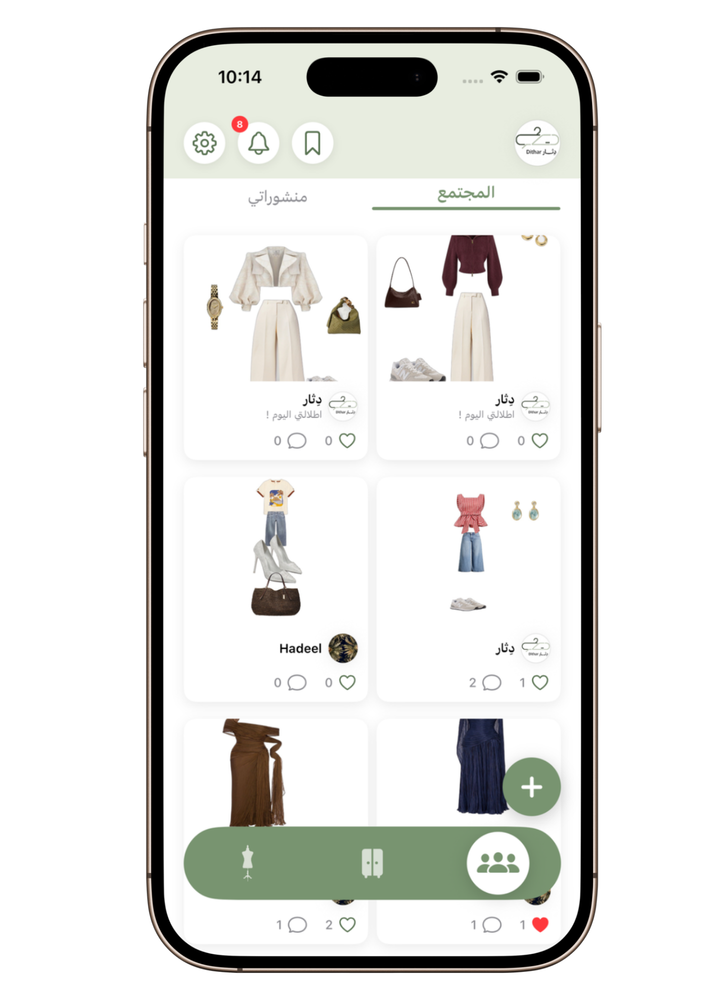
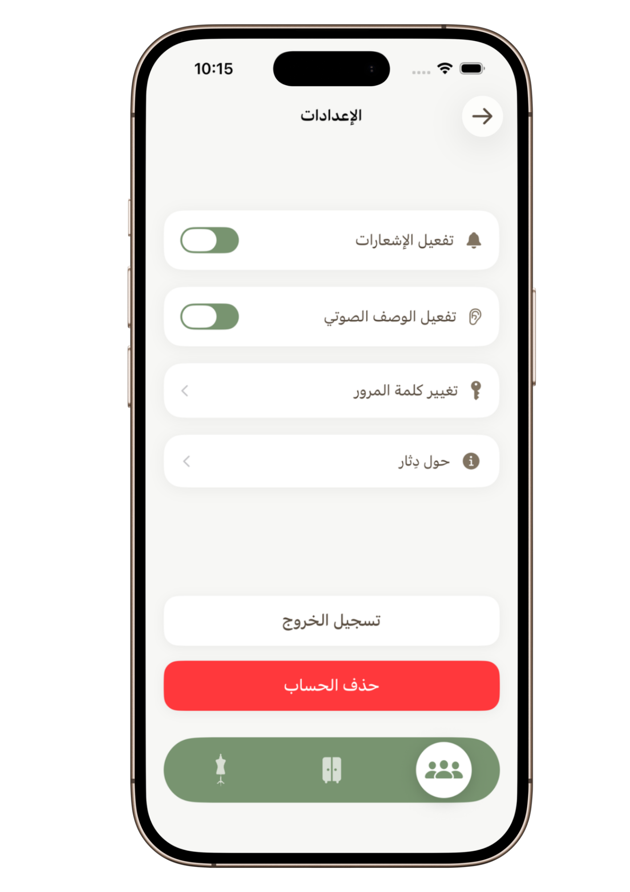

# Dithar
### AI-Powered Accessible Smart Wardrobe

**An intelligent, accessible smart wardrobe combining Artificial Intelligence, Generative AI, and RFID technology to empower independent clothing management and personal styling.**

[Website](https://dithar.site) • [Features](#core-features) • [AI Innovation](#generative-ai--intelligent-personal-styling) • [Screenshots](#screenshots)

---

## Overview

**Dithar** is an AI-powered smart wardrobe designed to help individuals identify, organize, manage, and coordinate their clothing independently.

The system combines an iOS application, AI-powered clothing recognition, UHF RFID technology, Raspberry Pi, Firebase, and accessible audio interaction to connect physical garments with an intelligent digital wardrobe.

Dithar is designed for everyday users, with a strong focus on empowering **blind and visually impaired individuals** to make independent clothing decisions.

Beyond traditional wardrobe management, Dithar incorporates an evolving **Generative AI and Agentic AI personal styling assistant** that understands Arabic-language styling requests, analyzes clothing compatibility, and develops personalized outfit recommendations using garments the user actually owns.

Our vision is to make clothing identification and personal styling more accessible, independent, and personalized.

---

## Project Preview

---

## Problem Statement

For individuals who are blind or have low vision, choosing what to wear can be a daily accessibility challenge.

Identifying clothing colors, patterns, and styles, distinguishing similar garments, locating specific items, and coordinating suitable outfits may require assistance from others.

This dependence can affect personal privacy, confidence, independence, and the freedom to express individual style.

Traditional wardrobe applications primarily rely on visual interfaces and manual clothing selection. Few solutions connect accessible garment identification, physical wardrobe tracking, intelligent styling, and audio interaction in a unified experience.

**Dithar addresses this gap by connecting physical clothing with accessible digital information and intelligent outfit coordination.**

---

## Our Solution

Dithar transforms a traditional wardrobe into an accessible, connected, and intelligent clothing management system.

The solution combines:

- AI-powered clothing recognition and visual attribute extraction
- RFID-based physical garment identification
- Real-time wardrobe inventory tracking
- Digital clothing organization and management
- Outfit creation and intelligent recommendations
- Accessible audio interaction for visually impaired users
- Community sharing and fashion inspiration
- Multimodal Generative AI styling capabilities
- Arabic conversational assistance and personalized styling
- Adaptive preference learning and intelligent outfit refinement

By connecting digital intelligence with physical garments, Dithar supports more independent clothing identification, management, and personal styling.

---

## Target Users

### Blind and Visually Impaired Users
- Individuals who need accessible garment identification
- Users who benefit from spoken clothing descriptions
- Users who want to coordinate outfits independently
- Individuals seeking greater privacy and personal autonomy in clothing decisions

### Everyday Users
- Individuals seeking easier wardrobe organization
- Users who want personalized outfit recommendations
- People who want to make better use of their existing clothing
- Users interested in smart home technology and AI-powered fashion

---

## Core Features

### 1. AI-Powered Clothing Recognition

Dithar uses AI-based image recognition to analyze clothing photographs and identify visual attributes such as:

- Garment type
- Color
- Pattern
- Clothing category

The original clothing recognition system is built around CLIP-based visual understanding.

Fashion-specific vision-language models are also being evaluated to expand clothing analysis and provide richer garment profiles.

After recognition, clothing items can be saved in the user's digital wardrobe and associated with RFID tags.

### 2. RFID-Based Clothing Identification and Tracking

Each garment can be connected to a unique UHF RFID tag.

The RFID reader and Raspberry Pi identify tagged clothing and connect physical items to their digital wardrobe records.

The system tracks garments entering and leaving the wardrobe, helping users understand clothing availability.

When a tagged garment is presented to the reader, Dithar can identify the item and provide access to its stored information.

This is particularly valuable for visually impaired users who may have difficulty distinguishing similar garments through touch alone.

### 3. Digital Wardrobe Management

Users can organize their clothing collection through the iOS application.

The digital wardrobe supports:

- Adding clothing items
- Clothing categorization
- RFID linking
- Searching and filtering
- Clothing availability tracking
- Accessing garment information
- Organizing personal wardrobe collections

### 4. Outfit Creator

Users can manually create complete outfits using garments from their digital wardrobe.

Outfits can be arranged, saved, and organized for future use.

Users can also create outfit collections for different occasions and personal needs.

### 5. Match a Similar Outfit

Through the Explore feature, users can discover outfit inspiration from community posts.

The **Match a Similar Outfit** feature analyzes the selected look and searches the user's existing wardrobe for similar garments.

The system uses clothing attributes to identify matching items and suggest available alternatives.

### 6. Outfit Recommendations

Dithar provides outfit recommendation functionality based on wardrobe contents and clothing information.

The recommendation system is being expanded with multimodal AI to improve visual coordination, contextual suitability, and personalized outfit selection.

### 7. Accessibility and Audio Interaction

Accessibility is a fundamental part of Dithar's design.

The application provides two complementary audio accessibility options:

**Apple VoiceOver**
- Supports screen-reader navigation
- Makes interface elements accessible through spoken feedback
- Helps visually impaired users interact with the application

**Dithar Audio Description System**
- Uses Apple's AVSpeechSynthesizer
- Provides spoken descriptions and interface information
- Offers an independent audio accessibility option

Together with RFID-based garment identification, these capabilities help visually impaired users recognize and manage their clothing without relying entirely on visual interaction.

### 8. Community Interaction

Dithar includes community features that allow users to:

- Share outfit posts
- Explore clothing inspiration
- Like and comment on shared looks
- Discover styling ideas
- Interact with other users

These features support social engagement and personal fashion exploration.

---

## Generative AI & Intelligent Personal Styling

Dithar is extending its existing smart wardrobe functionality through an advanced **Generative AI and Agentic AI personal styling system**.

The system builds upon the project's existing clothing recognition capabilities and introduces multimodal fashion understanding, contextual outfit planning, and personalized styling assistance.

This development aims to make visual fashion decisions more accessible to blind and visually impaired individuals.

### Multimodal Fashion Understanding

Dithar's AI development integrates specialized vision-language models, including **FashionSigLIP**, to analyze clothing characteristics and construct structured garment profiles.

**Qwen3-VL** is being integrated and evaluated for multimodal fashion reasoning, including:

- Visual harmony between garments
- Clothing compatibility
- Outfit composition
- Layering and styling decisions
- Occasion suitability
- Coordinated outfit recommendations

Unlike simple color-matching systems, the goal is to evaluate complete outfits and their overall visual coherence.

### Arabic Conversational AI Stylist

Dithar's evolving intelligent styling assistant combines LLM capabilities, including Google Gemini integration, with wardrobe-aware tools.

The assistant is designed to understand natural Arabic styling requests.

For example:

> "أبي لوك مرتب ومريح للجامعة، بدون كعب."

The assistant interprets the user's styling requirements, retrieves relevant wardrobe items, and generates outfit recommendations.

The system is also being developed to support conversational adjustments, such as:

> "غير الحذاء، وأضف جاكيت، وخله رسمي أكثر."

This enables users to refine outfits according to their needs rather than relying entirely on predefined recommendations.

### Agentic AI Architecture

Dithar's Agentic AI architecture connects language understanding, wardrobe information, outfit planning, and recommendation validation.

Its core responsibilities include:

- Understanding the user's styling intent
- Identifying occasions and clothing requirements
- Retrieving garments from the user's actual wardrobe
- Planning coordinated outfits
- Evaluating visual and contextual compatibility
- Respecting user preferences and restrictions
- Refining recommendations through conversation
- Providing understandable explanations

The objective is to create a wardrobe-aware intelligent assistant rather than a generic fashion chatbot.

### Adaptive Personalization

Dithar is developing preference-learning capabilities that use:

- Preferred clothing items
- Saved outfit selections
- User feedback
- Rejected suggestions
- Styling preferences

These signals will help the assistant progressively adapt recommendations to individual tastes.

### Reliable and Wardrobe-Aware Recommendations

The AI architecture incorporates validation mechanisms designed to:

- Recommend only garments that exist in the user's wardrobe
- Respect required and excluded items
- Check outfit completeness
- Consider occasion suitability
- Identify missing or uncertain garment information

These checks help ensure that AI-generated recommendations remain practical and grounded in the user's clothing collection.

### Accessible AI Styling

Dithar connects intelligent styling with its audio accessibility and RFID technologies.

The goal is to enable visually impaired users to understand recommended outfits through spoken descriptions and identify the corresponding physical garments.

This bridges the gap between digital fashion recommendations and independent real-world clothing selection.

### AI Development Status

**Implemented MVP:**
- iOS smart wardrobe application
- CLIP-based clothing recognition
- RFID garment identification and tracking
- Digital wardrobe management
- Outfit management and recommendation features
- VoiceOver and independent audio accessibility
- Community features

**AI Research and Active Development:**
- FashionSigLIP-based garment understanding
- Multimodal styling with Qwen3-VL
- Arabic natural-language request understanding
- Agentic AI tool orchestration
- Conversational outfit refinement
- Feedback-driven personalization
- Advanced outfit validation and ranking

The advanced AI modules are being developed, integrated, and evaluated. They are not yet presented as fully validated production features.

---

## System Architecture

### Existing Smart Wardrobe Architecture

The existing system connects:

1. The iOS application
2. AI-based clothing recognition
3. Firebase cloud services
4. RFID-tagged garments
5. UHF RFID reader and Raspberry Pi
6. Audio accessibility technologies

### Evolving AI Architecture

The Generative AI extension introduces a modular intelligence layer:

**Clothing Images → Visual Understanding → Structured Garment Profiles → Wardrobe-Aware Outfit Planning → Multimodal AI Styling → Recommendation Verification → Accessible Outfit Explanations**

An Agentic AI layer coordinates user requests, wardrobe information, styling tools, and personalization.

The original system architecture diagram represents the smart wardrobe MVP, while the advanced AI capabilities remain under development.

---

## System Workflow

### Clothing Registration

1. The user adds a garment image.
2. AI analyzes the clothing characteristics.
3. The garment information is saved in the digital wardrobe.
4. The item is linked to an RFID tag.
5. The physical garment can be identified through the reader.

### Intelligent Styling Workflow

The developing AI styling workflow includes:

1. Receiving an Arabic styling request.
2. Understanding the occasion, preferences, and requirements.
3. Retrieving available garments.
4. Generating complete outfit candidates.
5. Evaluating and refining recommendations.
6. Verifying selected garments and constraints.
7. Presenting personalized outfit recommendations.
8. Supporting accessible explanations and user feedback.

---

## Technology Stack

### Mobile Application
- Swift
- SwiftUI
- Xcode
- iOS

### Cloud and Database
- Firebase Authentication
- Firebase Firestore
- Firebase Storage

### AI and Computer Vision
- CLIP-based clothing recognition
- Python
- PyTorch
- FashionSigLIP — fashion understanding experiments
- Rule-based outfit and occasion logic

### Generative AI and Agentic Intelligence
- Google Gemini — LLM integration
- Qwen3-VL — multimodal styling development
- LLM-based agent orchestration
- Natural-language intent understanding
- Outfit evaluation and recommendation validation
- Adaptive personalization architecture

### Accessibility
- Apple VoiceOver
- AVSpeechSynthesizer
- Spoken clothing descriptions
- Accessible interface navigation

### IoT and Hardware
- UHF RFID Reader
- UHF RFID Tags
- Raspberry Pi
- Python-based hardware communication

### Development Tools
- Xcode
- Visual Studio Code
- Git and GitHub
- Google Colab for AI experimentation

---

## Hardware and Software Resources

### Hardware
- UHF RFID Reader
- UHF RFID Tags
- Raspberry Pi
- iPhone test device
- GPU-enabled development environment for AI experimentation

### Software
- Xcode
- Firebase
- Python
- PyTorch
- AI vision-language models
- Google Colab
- Visual Studio Code

---

## Results and Project Value

Dithar brings together accessible technology, IoT, and artificial intelligence to support everyday clothing decisions.

The system:

- Improves digital wardrobe organization
- Connects physical garments to accessible information
- Enables RFID-based garment tracking
- Supports clothing recognition through AI
- Provides accessible audio interaction
- Facilitates outfit creation and management
- Encourages greater independence for visually impaired users
- Supports personal expression and privacy
- Offers community-based styling inspiration

The ongoing Generative AI development extends these capabilities toward more intelligent, personalized, and conversational outfit recommendations.

### Real-World Impact

Dithar aims to reduce reliance on sighted assistance by enabling blind and visually impaired users to independently identify, understand, and coordinate their clothing.

The project's accessibility impact can be evaluated through:

- Independent garment identification
- Successful outfit selection
- Task completion time
- Accessible navigation performance
- User satisfaction and feedback
- Independence in everyday wardrobe activities

Our long-term goal is to make personal styling a more independent, inclusive, and empowering experience.

---

## Screenshots

---

## Team

**Developed by:**
- Rahaf AlFantoukh
- Hadeel Almutairi
- Maha Alswed
- Fatimah Alsufaian

**Supervised by:**
- Dr. Wejdan Alkhaldi

---

## Acknowledgments

- King Saud University
- College of Computer and Information Sciences
- Department of Information Technology

---

## Project Website

https://dithar.site

---

**Dithar — Making Clothing Independence Accessible Through AI and IoT.**

Developed as a graduation project and continuously evolving toward intelligent, accessible, and personalized wardrobe assistance.
